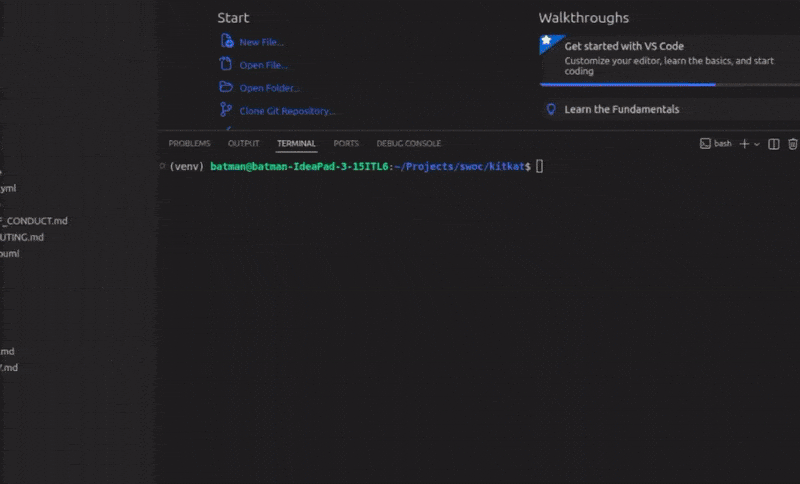
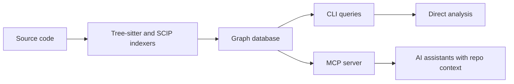
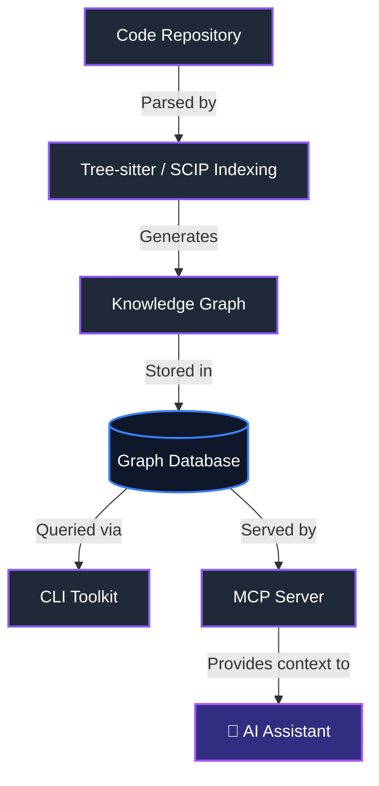

# 🏗️ CodeGraphContext (CGC)

**कोड रिपॉज़िटरी को एक क्वेरी-योग्य ग्राफ़ में बदलें, ताकि AI एजेंट उसे समझ सकें।**

🌐 **भाषाएँ:**

- 🇬🇧 [English](../../README.md)
- 🇨🇳 [中文](README.zh-CN.md)
- 🇰🇷 [한국어](README.kor.md)
- 🇺🇦 [Українська](README.uk.md)
- 🇷🇺 [Русский](README.ru-RU.md)
- 🇯🇵 [日本語](README.ja.md)
- 🇮🇳 [தமிழ்](README.ta.md)
- 🇮🇳 [हिन्दी](README.hi.md)
- 🇪🇸 Español (जल्द आ रहा है)

🌍 **CodeGraphContext को अपनी भाषा में उपलब्ध कराने में मदद करें। [GitHub Issues](https://github.com/CodeGraphContext/CodeGraphContext/issues) पर एक issue बनाएँ और PR भेजें!**

**गहरे कोड ग्राफ़ और AI कॉन्टेक्स्ट के बीच की दूरी को पाटें।**

[](https://pypi.org/project/codegraphcontext/)
[](https://pypi.org/project/codegraphcontext/)
[](https://github.com/CodeGraphContext/CodeGraphContext/blob/main/LICENSE)
[](https://github.com/CodeGraphContext/CodeGraphContext)
[](https://discord.gg/VCwUdCnn)

[](https://github.com/CodeGraphContext/CodeGraphContext/stargazers)
[](https://github.com/CodeGraphContext/CodeGraphContext/network/members)
[](https://github.com/CodeGraphContext/CodeGraphContext/issues)
[](https://github.com/CodeGraphContext/CodeGraphContext/pulls)
[](https://github.com/CodeGraphContext/CodeGraphContext/graphs/contributors)

[](https://github.com/CodeGraphContext/CodeGraphContext/actions/workflows/test.yml)
[](https://github.com/CodeGraphContext/CodeGraphContext/actions/workflows/e2e-tests.yml)
[](https://youtu.be/KYYSdxhg1xU)

यह एक शक्तिशाली **MCP सर्वर** और **CLI टूलकिट** है, जो लोकल कोड को एक ग्राफ़ डेटाबेस में इंडेक्स करता है और AI असिस्टेंट्स तथा डेवलपर्स को कोड का संदर्भ (context) उपलब्ध कराता है। आप इसे व्यापक कोड विश्लेषण के लिए स्टैंडअलोन CLI के रूप में इस्तेमाल कर सकते हैं, या अपने पसंदीदा AI IDE से MCP के ज़रिए जोड़कर AI-आधारित कोड समझ का लाभ उठा सकते हैं।

* * *

## 📍 त्वरित नेविगेशन

- [🚀 क्विक स्टार्ट](#-इंस्टॉलेशन-और-क्विक-स्टार्ट)
- [📋 पूर्वापेक्षाएँ](#-पूर्वापेक्षाएँ)
- [🏃 प्रोजेक्ट को लोकली कैसे चलाएँ](#-प्रोजेक्ट-को-लोकली-कैसे-चलाएँ)
- [🌐 समर्थित प्रोग्रामिंग भाषाएँ](#समर्थित-प्रोग्रामिंग-भाषाएँ)
- [🛠️ CLI टूलकिट](#cli-टूलकिट-मोड-के-लिए)
- [🤖 MCP सर्वर](#-mcp-सर्वर-मोड-के-लिए)
- [🗄️ डेटाबेस विकल्प](#डेटाबेस-विकल्प)
- [🔬 SCIP इंडेक्सिंग (वैकल्पिक)](#scip-इंडेक्सिंग-वैकल्पिक)

* * *

## ✨ CGC का अनुभव लें

### 👨🏻‍💻 इंस्टॉलेशन और CLI

> pip से कुछ ही सेकंड में इंस्टॉल करें और कोड ग्राफ़ विश्लेषण के लिए शक्तिशाली CLI पाएँ।
> [](https://github.com/CodeGraphContext/CodeGraphContext/blob/main/images/install&cli.gif)

### 🛠️ सेकंडों में इंडेक्सिंग

> CLI ग्राफ़ बनाने के लिए आपके tree-sitter नोड्स को समझदारी से पार्स करता है।
> [](https://github.com/CodeGraphContext/CodeGraphContext/blob/main/images/Indexing.gif)

### 🤖 अपने AI असिस्टेंट को सशक्त बनाएँ

> MCP के ज़रिए सामान्य भाषा में जटिल कॉल-चेन्स की क्वेरी करें।
> [](https://github.com/CodeGraphContext/CodeGraphContext/blob/main/images/Usecase.gif)

* * *

## CodeGraphContext क्यों?

CodeGraphContext उस मोड़ के लिए बना है, जब सादा टेक्स्ट सर्च काफ़ी नहीं रह जाता। यह किसी रिपॉज़िटरी को फ़ाइलों, सिंबल्स, कॉल्स, इनहेरिटेंस, इम्पोर्ट्स और उनके आपसी संबंधों के ग्राफ़ में बदल देता है, ताकि आप अलग-अलग टूल्स के बीच भटके बिना "यह कहाँ परिभाषित है?" से आगे बढ़कर "यह आपस में वास्तव में कैसे जुड़ा है?" तक पहुँच सकें।



### एक नज़र में तुलना

| तरीका                | किसके लिए सबसे उपयुक्त       | कमी                                              |
|----------------------|------------------------------|--------------------------------------------------|
| `grep` / फ़ाइल सर्च   | सटीक स्ट्रिंग खोज             | संबंध और कोड संरचना छूट जाती है                   |
| कोड चंक्स पर RAG      | प्राकृतिक भाषा में खोज        | सिंबल-स्तर की सटीकता घट सकती है                   |
| CodeGraphContext     | पूरी रिपॉज़िटरी पर तर्क-विश्लेषण | इंडेक्सिंग का एक चरण ज़रूरी है                    |

### आम उपयोग

- फ़ाइलों और पैकेजों के पार कॉल चेन्स को ट्रेस करना।
- क्लास हायरार्की, इम्पोर्ट्स और मॉड्यूल की सीमाओं को समझना।
- डेड कोड, हॉटस्पॉट और अप्रत्याशित डिपेंडेंसी खोजना।
- AI असिस्टेंट को वही संरचनात्मक संदर्भ देना जो एक मेंटेनर के पास होता है।

### अक्सर पूछे जाने वाले प्रश्न

- **क्या मुझे किसी रिमोट सर्विस की ज़रूरत है?** नहीं। CGC एम्बेडेड बैकएंड के साथ लोकली काम करता है, और ज़रूरत पड़ने पर बाहरी ग्राफ़ डेटाबेस के साथ भी चल सकता है।
- **क्या यह सिर्फ़ एक भाषा के लिए है?** नहीं। यह मुख्यधारा की कई भाषाओं को सपोर्ट करता है और इनका दायरा बढ़ता जा रहा है।
- **क्या मैं इसे AI असिस्टेंट के साथ इस्तेमाल कर सकता/सकती हूँ?** हाँ। MCP सर्वर का मुख्य उद्देश्य यही है।

* * *

## प्रोजेक्ट विवरण

- **वर्ज़न:** [PyPI पर नवीनतम रिलीज़](https://pypi.org/project/codegraphcontext/)
- **लेखक:** Shashank Shekhar Singh [shashankshekharsingh1205@gmail.com](mailto:shashankshekharsingh1205@gmail.com)
- **लाइसेंस:** MIT लाइसेंस (विवरण के लिए [LICENSE](https://github.com/CodeGraphContext/CodeGraphContext/blob/main/LICENSE) देखें)
- **वेबसाइट:** [CodeGraphContext](http://codegraphcontext.vercel.app/)

* * *

## 👨‍💻 मेंटेनर

**CodeGraphContext** को इन्होंने बनाया है और सक्रिय रूप से मेंटेन करते हैं:

**Shashank Shekhar Singh**

- 📧 ईमेल: [shashankshekharsingh1205@gmail.com](mailto:shashankshekharsingh1205@gmail.com)
- 🐙 GitHub: [@Shashankss1205](https://github.com/Shashankss1205)
- 🔗 LinkedIn: [Shashank Shekhar Singh](https://www.linkedin.com/in/shashank-shekhar-singh-a67282228/)
- 🌐 वेबसाइट: [codegraphcontext.vercel.app](https://codegraphcontext.vercel.app/)

*योगदान और फ़ीडबैक का हमेशा स्वागत है! सवाल, सुझाव या सहयोग के अवसरों के लिए बेझिझक संपर्क करें।*

* * *

## स्टार हिस्ट्री

[Star History Chart ↗](https://www.star-history.com/#CodeGraphContext/CodeGraphContext&Date)

* * *

## विशेषताएँ

- **कोड इंडेक्सिंग:** कोड का विश्लेषण करता है और उसके घटकों का नॉलेज ग्राफ़ बनाता है।
- **संबंध विश्लेषण:** callers, callees, क्लास हायरार्की, कॉल चेन्स आदि की क्वेरी करें।
- **पहले से इंडेक्स किए गए बंडल:** `.cgc` बंडल से प्रसिद्ध रिपॉज़िटरी तुरंत लोड करें, इंडेक्सिंग की ज़रूरत नहीं! ([और जानें](https://github.com/CodeGraphContext/CodeGraphContext/blob/main/docs/docs/guides/bundles.md))
- **लाइव फ़ाइल वॉचिंग:** डायरेक्टरी में बदलावों पर नज़र रखें और ग्राफ़ को रियल-टाइम में अपने-आप अपडेट करें (`cgc watch`)।
- **इंटरैक्टिव सेटअप:** आसान सेटअप के लिए यूज़र-फ्रेंडली कमांड-लाइन विज़ार्ड।
- **दोहरा मोड:** डेवलपर्स के लिए स्टैंडअलोन **CLI टूलकिट** और AI एजेंट्स के लिए **MCP सर्वर**, दोनों रूपों में काम करता है।
- **बहु-भाषा समर्थन:** 23 प्रोग्रामिंग भाषाओं के लिए पूर्ण समर्थन।
- **लचीला डेटाबेस बैकएंड:** FalkorDB Lite (डिफ़ॉल्ट), KuzuDB, LadybugDB, FalkorDB Remote, Nornic DB, या Neo4j (सभी प्लेटफ़ॉर्म पर Docker/नेटिव के ज़रिए)।

* * *

## 🏗️ आर्किटेक्चर और वर्कफ़्लो

CodeGraphContext आपके सोर्स कोड को पार्स करके एक व्यापक नॉलेज ग्राफ़ बनाता है। इस ग्राफ़ को सीधे CLI टूलकिट से क्वेरी किया जा सकता है, या MCP सर्वर के ज़रिए AI असिस्टेंट्स को उपलब्ध कराया जा सकता है।



* * *

## समर्थित प्रोग्रामिंग भाषाएँ

CodeGraphContext निम्नलिखित भाषाओं के लिए व्यापक पार्सिंग और विश्लेषण प्रदान करता है:

|     | भाषा                           |    | भाषा                   |    | भाषा           |
|:----|:-------------------------------|:---|:-----------------------|:---|:---------------|
| 🐍   | **Python**                     | 📜  | **JavaScript**         | 🔷  | **TypeScript** |
| ☕   | **Java**                       | 🔵  | **C**                  | ➕  | **C++**        |
| #️⃣ | **C#**                         | 🐹  | **Go**                 | 🦀  | **Rust**       |
| 💎   | **Ruby**                       | 🐘  | **PHP**                | 🍎  | **Swift**      |
| 🎨   | **Kotlin**                     | 🎯  | **Dart**               | 🐪  | **Perl**       |
| 🌙   | **Lua**                        | 🚀  | **Scala**              | λ  | **Haskell**    |
| 💧   | **Elixir**                     | 📜  | **Emacs Lisp (elisp)** | 🌐  | **HTML**       |
| 🎨   | **CSS**                        | ⚛️ | **TSX**                | ⛓️ | **Solidity**   |
| 🏗️  | **HCL (Terraform/Terragrunt)** |    |                        |    |                |

प्रत्येक भाषा का पार्सर functions, classes, methods, parameters, इनहेरिटेंस संबंध, function calls और imports निकालकर एक व्यापक कोड ग्राफ़ तैयार करता है।

**HCL नोट्स:** `.tf`, `.tfvars` और `.hcl` फ़ाइलें Terraform, OpenTofu और Terragrunt को कवर करती हैं। HCL में कॉल नहीं, बल्कि घोषणाएँ होती हैं, इसलिए यह ब्लॉक्स, वेरिएबल्स और क्रॉस-कॉन्फ़िगरेशन imports देता है, पर function calls नहीं। देखें `docs/docs/contributing_languages.md` का § HCL।

**Solidity नोट्स:** `.sol` के लिए `tree-sitter-language-pack` के ज़रिए Tree-sitter का उपयोग होता है (SCIP नहीं)। इसमें Foundry remappings, modifier invocations, `using Lib for T`, और `emit` / custom-error `revert` को CALLS के रूप में सपोर्ट किया जाता है। देखें `docs/docs/contributing_languages.md` का § Solidity।

**Kotlin नोट्स:** Annotations को functions और classes पर `decorators` के रूप में दर्ज किया जाता है, और उनके arguments भी सुरक्षित रहते हैं (जैसे `@Preview(showBackground = true)`)। इससे `find_dead_code` का `exclude_decorated_with` फ़िल्टर Kotlin और Android कोडबेस पर काम करने लायक बनता है, उदाहरण के लिए `Composable`, `Preview`, `Test` और `Provides` को बाहर रखने के लिए। यह फ़िल्टर functions पर मिलान करता है, इसलिए क्लास-स्तर के annotations का इस पर असर नहीं पड़ता। interfaces, objects, constructors, parameters और properties पर लगे annotations अभी दर्ज नहीं किए जाते।

* * *

## डेटाबेस विकल्प

CodeGraphContext आपके वातावरण के अनुसार कई ग्राफ़ डेटाबेस बैकएंड सपोर्ट करता है:

| विशेषता             | KuzuDB                                                    | LadybugDB                              | FalkorDB Lite                                                        | Neo4j / Nornic DB                              |
|:--------------------|:----------------------------------------------------------|:---------------------------------------|:---------------------------------------------------------------------|:-----------------------------------------------|
| **सामान्य डिफ़ॉल्ट**  | FalkorDB Lite उपलब्ध न होने पर क्रॉस-प्लेटफ़ॉर्म फ़ॉलबैक         | वैकल्पिक एम्बेडेड बैकएंड                  | **Unix पर डिफ़ॉल्ट** (Python 3.12+, `falkordblite` इंस्टॉल होने पर)        | जब `cgc config db` से स्पष्ट रूप से चुना जाए        |
| **सेटअप**           | ज़ीरो-कॉन्फ़िग / एम्बेडेड                                        | ज़ीरो-कॉन्फ़िग / एम्बेडेड                      | ज़ीरो-कॉन्फ़िग / इन-प्रोसेस                                                | Docker / बाहरी                                  |
| **प्लेटफ़ॉर्म**        | **सभी (Windows नेटिव, macOS, Linux)**                         | **सभी (Windows नेटिव, macOS, Linux)**      | केवल Unix (Linux/macOS/WSL)                                          | सभी प्लेटफ़ॉर्म                                   |
| **उपयोग**           | डेस्कटॉप, IDE, लोकल डेवलपमेंट                                  | कस्टम रिसर्च प्रोजेक्ट्स                      | विशिष्ट Unix डेवलपमेंट                                                  | एंटरप्राइज़, बहुत बड़े ग्राफ़                        |
| **आवश्यकता**        | `pip install kuzu`                                        | `pip install ladybug`                  | `pip install falkordblite`                                           | Neo4j सर्वर / Docker / Nornic Cloud           |
| **गति**             | ⚡ बेहद तेज़                                                  | ⚡ तेज़                                  | 🚀 स्केलेबल                                                             | 🌐 नेटवर्क पर निर्भर                              |
| **परसिस्टेंस**       | हाँ (डिस्क पर)                                              | हाँ (डिस्क पर)                           | हाँ (डिस्क पर)                                                         | हाँ (सर्वर-साइड)                                 |

एम्बेडेड KuzuDB/LadybugDB डिफ़ॉल्ट रूप से **4 GiB** का buffer pool इस्तेमाल करते हैं (`CGC_EMBEDDED_BUFFER_POOL_MB`)। इस env var में कोई दूसरा MiB मान दें, या लाइब्रेरी का डिफ़ॉल्ट (सिस्टम RAM का लगभग 80%) पाने के लिए `0` सेट करें।

* * *

## SCIP इंडेक्सिंग (वैकल्पिक)

जब आपके CGC कॉन्फ़िग (`~/.codegraphcontext/.env`) में `SCIP_INDEXER=true` होता है, तब कुछ भाषाएँ केवल Tree-sitter के अनुमान-आधारित तरीकों की तुलना में अधिक सटीक calls और इनहेरिटेंस के लिए बाहरी **SCIP** इंडेक्सर्स का उपयोग करती हैं।

**C और C++** **scip-clang** का उपयोग करते हैं, जिसके लिए **`compile_commands.json`** फ़ाइल ([JSON compilation database](https://clang.llvm.org/docs/JSONCompilationDatabase.html)) चाहिए: हर translation unit के लिए एक एंट्री, जिसमें असली कंपाइलर कमांड (include paths, `-D` defines, `-std` आदि) हो। इसके बिना scip-clang नहीं चल सकता; CGC चेतावनी लॉग करता है और उस रिपॉज़िटरी के लिए **Tree-sitter पर लौट आता है**। यह फ़ाइल बनाने के आम तरीके: **CMake** के साथ `-DCMAKE_EXPORT_COMPILE_COMMANDS=ON`, या अपनी असली बिल्ड को [**Bear**](https://github.com/rizsotto/Bear) से रैप करना (जैसे `bear -- make`)। CGC इस फ़ाइल को `build/` और `cmake-build-*/` के अंदर भी खोजता है।

**C#** **scip-dotnet** (Roslyn) का उपयोग करता है; इसके लिए सामान्य **`.csproj` / `.sln`** और सफल restore चाहिए। `compile_commands.json` की ज़रूरत नहीं।

SCIP इस बात से **स्वतंत्र** है कि आप कौन-सा ग्राफ़ डेटाबेस इस्तेमाल करते हैं (Kuzu, Neo4j आदि); वही फ़्लैग सभी बैकएंड पर लागू होता है।

* * *

## इस्तेमाल करने वाले

CodeGraphContext को डेवलपर्स और प्रोजेक्ट्स पहले से इन कामों के लिए आज़मा रहे हैं:

- **AI असिस्टेंट्स में स्टैटिक कोड विश्लेषण**
- **प्रोजेक्ट्स का ग्राफ़-आधारित विज़ुअलाइज़ेशन**
- **डेड कोड और जटिलता (complexity) की पहचान**

*अगर आप अपने प्रोजेक्ट में CodeGraphContext इस्तेमाल कर रहे हैं, तो यहाँ जोड़ने के लिए बेझिझक PR खोलें! 🚀*

* * *

## डिपेंडेंसीज़

- `neo4j>=5.15.0`
- `watchdog>=3.0.0`
- `stdlibs>=2023.11.18`
- `typer>=0.9.0`
- `rich>=13.7.0`
- `inquirerpy>=0.3.4`
- `python-dotenv>=1.0.0`
- `tree-sitter>=0.24.0,<0.26.0`
- `tree-sitter-language-pack>=1.6,<2.0`
- `pyyaml`
- `pathspec>=0.12.1`
- `falkordb>=1.0,<1.6`
- `falkordblite>=0.7,<0.10` (केवल Unix, Python 3.12+)
- `kuzu` (KuzuDB इंजन)
- `fastapi>=0.100.0`
- `uvicorn>=0.22.0`
- `requests>=2.28.0`
- `protobuf>=3.20,<3.21`

**नोट:** Python 3.10 से 3.14 तक समर्थित है।

* * *

### 🚀 इंस्टॉलेशन और क्विक स्टार्ट

1. **टूलकिट इंस्टॉल करें:**

   ```bash
   pip install codegraphcontext
   ```

2. **समस्या-निवारण (Command not found):** अगर `codegraphcontext` कमांड नहीं मिलती, तो यह एक-लाइन वाला फ़िक्स चलाएँ:

   ```bash
   curl -sSL https://raw.githubusercontent.com/CodeGraphContext/CodeGraphContext/main/scripts/post_install_fix.sh | bash
   ```

3. **डेटाबेस सेटअप (स्वचालित):** CodeGraphContext डिफ़ॉल्ट रूप से एक एम्बेडेड ग्राफ़ डेटाबेस इस्तेमाल करता है।

   - **FalkorDB Lite:** डिफ़ॉल्ट बैकएंड।
   - **KuzuDB:** क्रॉस-प्लेटफ़ॉर्म एम्बेडेड बैकएंड।
   - **Neo4j:** बाहरी सर्वर इस्तेमाल करने के लिए `codegraphcontext neo4j setup` चलाएँ।

### 🧪 लोकल डेवलपमेंट सेटअप

अगर आप लोकल क्लोन से CodeGraphContext चलाना और बदलाव योगदान करना चाहते हैं, तो editable इंस्टॉल का उपयोग करें:

```bash
git clone https://github.com/CodeGraphContext/CodeGraphContext.git
cd CodeGraphContext
python -m venv .venv
source .venv/bin/activate
pip install -e ".[dev]"
```

फिर इंस्टॉलेशन जाँचें और लोकल कमांड आज़माएँ:

```bash
cgc --help
cgc doctor
cgc index .
cgc analyze callers main
```

MCP सर्वर पर काम करने के लिए, सेटअप को इस तरह पूरा करें:

```bash
cgc mcp setup
cgc mcp start
```

अगर आप केवल प्रकाशित पैकेज इस्तेमाल कर रहे हैं, तो `pip install codegraphcontext` काफ़ी है। अगर आप पार्सर-आधारित फ़ीचर्स विकसित कर रहे हैं और वैकल्पिक parsing extras भी चाहते हैं, तो `pip install -e ".[dev,parsing]"` से इंस्टॉल करें।

* * *

## 🐳 Docker (Python की ज़रूरत नहीं)

Python इंस्टॉल किए बिना CodeGraphContext चलाएँ। बस इमेज पुल करें और इंडेक्सिंग शुरू करें:

### क्विक स्टार्ट

```bash
# Pull the latest image
docker pull codegraphcontext/codegraphcontext:latest

# Index your current directory
docker run --rm -v "$(pwd):/workspace" codegraphcontext/codegraphcontext cgc index .

# List indexed repos
docker run --rm -v cgc-data:/home/cgc/.codegraphcontext \
    codegraphcontext/codegraphcontext cgc list

# Interactive shell
docker run -it --rm -v "$(pwd):/workspace" \
    -v cgc-data:/home/cgc/.codegraphcontext \
    codegraphcontext/codegraphcontext bash
```

### Docker Compose

```bash
# Clone the repo and start with Docker Compose
git clone https://github.com/CodeGraphContext/CodeGraphContext.git
cd CodeGraphContext

# Start with embedded DB
docker compose run --rm cgc index .

# Start with external FalkorDB
docker compose --profile falkordb up -d

# Start with visualization server
docker compose --profile viz up -d
# Open http://localhost:8080
```

### उपलब्ध Docker टैग

| टैग      | विवरण                                       |
|----------|---------------------------------------------|
| `latest` | नवीनतम स्थिर रिलीज़                           |
| `edge`   | `main` ब्रांच का नवीनतम (अस्थिर हो सकता है)     |
| `0.4.19` | विशिष्ट वर्ज़न                                 |
| `0.4`    | 0.4.x का नवीनतम पैच                           |

MCP सर्वर चलाने या बाहरी डेटाबेस जोड़ने जैसे उन्नत Docker उपयोग के लिए हमारी [विस्तृत Docker गाइड](https://github.com/CodeGraphContext/CodeGraphContext/blob/main/docs/DOCKER.md) देखें।

* * *

## 📋 पूर्वापेक्षाएँ

CodeGraphContext इंस्टॉल करने से पहले सुनिश्चित करें कि आपके पास ये हैं:

- Python 3.10 या उससे नया
- pip पैकेज मैनेजर
- Git (वैकल्पिक, रिपॉज़िटरी क्लोन करने के लिए)

अपना Python इंस्टॉलेशन जाँचें:

```bash
python --version
```

* * *

## 🚀 चरण-दर-चरण सेटअप गाइड

### चरण 1: CodeGraphContext इंस्टॉल करें

```bash
pip install codegraphcontext  # Installs CodeGraphContext and required dependencies
```

यह कमांड CodeGraphContext और सभी ज़रूरी डिपेंडेंसीज़ इंस्टॉल कर देती है।

### चरण 2: इंस्टॉलेशन सत्यापित करें

```bash
codegraphcontext --help
```

अगर यह उपलब्ध CLI कमांड्स दिखाता है, तो इंस्टॉलेशन सफल रहा।

### चरण 3: डेटाबेस सेटअप

CodeGraphContext डिफ़ॉल्ट रूप से एम्बेडेड डेटाबेस इस्तेमाल करता है, इसलिए ज़्यादातर यूज़र्स को किसी अतिरिक्त कॉन्फ़िगरेशन की ज़रूरत नहीं पड़ती।

* * *

## 🏃 प्रोजेक्ट को लोकली कैसे चलाएँ

### रिपॉज़िटरी इंडेक्स करें

```bash
codegraphcontext index .  # Scans current directory and builds code graph
```

यह मौजूदा प्रोजेक्ट को स्कैन करता है और एक खोजने-योग्य कोड ग्राफ़ बनाता है।

### इंडेक्स की गई रिपॉज़िटरी देखें

```bash
codegraphcontext list
```

CodeGraphContext द्वारा अभी इंडेक्स की गई सभी रिपॉज़िटरी दिखाता है।

### कोड का विश्लेषण करें

```bash
codegraphcontext analyze dead-code
```

इंडेक्स की गई रिपॉज़िटरी में संभावित रूप से अप्रयुक्त कोड खोजता है।

* * *

## ✅ जाँचें कि सब कुछ ठीक चल रहा है

किसी रिपॉज़िटरी को इंडेक्स करने के बाद यह चलाएँ:

```bash
codegraphcontext list  # Shows all indexed repositories in the system
```

अगर कमांड सफलतापूर्वक चलती है और इंडेक्स की गई रिपॉज़िटरी दिखाती है, तो आपका सेटअप पूरा है और CodeGraphContext इस्तेमाल के लिए तैयार है।

### CLI टूलकिट मोड के लिए

**CLI कमांड्स के साथ तुरंत शुरू करें:**

```bash
# Index your current directory
codegraphcontext index .

# List all indexed repositories
codegraphcontext list

# Analyze who calls a function
codegraphcontext analyze callers my_function

# Find complex code
codegraphcontext analyze complexity --threshold 10

# Find dead code
codegraphcontext analyze dead-code

# Watch for live changes (optional)
codegraphcontext watch .

# See all commands
codegraphcontext help
```

**सभी उपलब्ध कमांड्स और उपयोग के परिदृश्यों के लिए पूरी [CLI कमांड्स गाइड](https://github.com/CodeGraphContext/CodeGraphContext/blob/main/docs/CLI_COMPLETE_REFERENCE.md) देखें।**

### 🎨 प्रीमियम इंटरैक्टिव विज़ुअलाइज़ेशन

CodeGraphContext आपके कोड के शानदार, इंटरैक्टिव नॉलेज ग्राफ़ बना सकता है। स्थिर डायग्राम के उलट, ये वेब-आधारित प्रीमियम एक्सप्लोरर हैं:

- **प्रीमियम सौंदर्य**: डार्क मोड, glassmorphism और आधुनिक टाइपोग्राफ़ी (Outfit/JetBrains Mono)।
- **इंटरैक्टिव निरीक्षण**: किसी भी नोड पर क्लिक करके साइड पैनल खोलें, जिसमें सिंबल की जानकारी, फ़ाइल पाथ और संदर्भ दिखता है।
- **त्वरित खोज**: ग्राफ़ में लाइव सर्च करके किसी भी सिंबल को तुरंत ढूँढें।
- **समझदार लेआउट**: Force-directed और hierarchical लेआउट, जो जटिल संबंधों को पढ़ने-योग्य बनाते हैं।
- **बिना डिपेंडेंसी के व्यूइंग**: स्टैंडअलोन HTML फ़ाइलें, जो किसी भी आधुनिक ब्राउज़र में चलती हैं।

```bash
# Visualize function calls
codegraphcontext analyze calls my_function --viz

# Explore class hierarchies
codegraphcontext analyze tree MyClass --viz

# Visualize search results
codegraphcontext find pattern "Auth" --viz
```

* * *

### 🤖 MCP सर्वर मोड के लिए

**अपने AI असिस्टेंट को CodeGraphContext इस्तेमाल करने के लिए कॉन्फ़िगर करें:**

1. **सेटअप:** अपने IDE/AI असिस्टेंट को कॉन्फ़िगर करने के लिए MCP सेटअप विज़ार्ड चलाएँ:

   ```bash
   codegraphcontext mcp setup
   ```

   विज़ार्ड इन्हें अपने-आप पहचानकर कॉन्फ़िगर कर सकता है:

   - VS Code
   - Cursor
   - Windsurf
   - Zed
   - Claude
   - Gemini CLI
   - ChatGPT Codex
   - Cline
   - RooCode
   - Amazon Q Developer
   - Kiro
   - Goose
   - OpenCode

   सफल कॉन्फ़िगरेशन के बाद, `codegraphcontext mcp setup` ज़रूरी कॉन्फ़िगरेशन फ़ाइलें बनाकर सही जगह रख देता है:

   - यह आपकी मौजूदा डायरेक्टरी में संदर्भ के लिए एक `mcp.json` फ़ाइल बनाता है।
   - यह आपके डेटाबेस क्रेडेंशियल्स को `~/.codegraphcontext/.env` में सुरक्षित रूप से रखता है।
   - यह आपके चुने हुए IDE/CLI की सेटिंग्स फ़ाइल (जैसे `.claude.json` या VS Code की `settings.json`) अपडेट करता है।

2. **शुरू करें:** MCP सर्वर लॉन्च करें:

   ```bash
   codegraphcontext mcp start
   ```

3. **उपयोग करें:** अब अपने AI असिस्टेंट के ज़रिए सामान्य भाषा में अपने कोडबेस से बातचीत करें! नीचे उदाहरण देखें।

* * *

## फ़ाइलों को अनदेखा करना (`.cgcignore`)

आप अपने प्रोजेक्ट की रूट डायरेक्टरी में `.cgcignore` फ़ाइल बनाकर CodeGraphContext को कुछ फ़ाइलों और डायरेक्टरी को अनदेखा करने के लिए कह सकते हैं। इसमें `.gitignore` जैसी ही सिंटैक्स चलती है।

**`.cgcignore` फ़ाइल का उदाहरण:**

```
# Ignore build artifacts
/build/
/dist/

# Ignore dependencies
/node_modules/
/vendor/

# Ignore logs
*.log
```

* * *

## MCP क्लाइंट कॉन्फ़िगरेशन

`codegraphcontext mcp setup` कमांड आपके IDE/CLI को अपने-आप कॉन्फ़िगर करने की कोशिश करती है। अगर आप ऑटोमैटिक सेटअप इस्तेमाल नहीं करना चाहते, या आपका टूल समर्थित नहीं है, तो आप इसे मैन्युअली कॉन्फ़िगर कर सकते हैं।

अपने क्लाइंट की सेटिंग्स फ़ाइल (जैसे VS Code की `settings.json` या `.claude.json`) में यह सर्वर कॉन्फ़िगरेशन जोड़ें:

```json
{
  "mcpServers": {
    "CodeGraphContext": {
      "command": "codegraphcontext",
      "args": [
        "mcp",
        "start"
      ],
      "disabled": false,
      "alwaysAllow": []
    }
  }
}
```

#### OpenCode कॉन्फ़िगरेशन

OpenCode के साथ MCP सर्वर इंस्टॉल और कॉन्फ़िगर करने के निर्देशों के लिए [OpenCode MCP गाइड](https://opencode.ai/docs/ko/mcp-servers/#_top) देखें।

#### अगर pipx से इंस्टॉल किया है

अगर आपने CodeGraphContext को `pipx` से इंस्टॉल किया है, तो इसके बजाय यह कॉन्फ़िगरेशन इस्तेमाल करें:

```json
{
  "mcpServers": {
    "CodeGraphContext": {
      "command": "pipx",
      "args": [
        "run",
        "codegraphcontext",
        "mcp",
        "start"
      ],
      "env": {
        "NEO4J_URI": "YOUR_NEO4J_URI",
        "NEO4J_USERNAME": "YOUR_NEO4J_USERNAME",
        "NEO4J_PASSWORD": "YOUR_NEO4J_PASSWORD"
      },
      "disabled": false,
      "alwaysAllow": []
    }
  }
}
```

* * *

## टोकन-अनुकूलित आउटपुट (GCF)

वैकल्पिक [GCF](https://gcformat.com) आउटपुट फ़ॉर्मेट से टूल रिस्पॉन्स के टोकन लगभग ~62% तक घटाएँ:

```bash
pip install gcf-python
CGC_OUTPUT_FORMAT=gcf codegraphcontext mcp start
```

या इसे अपने MCP क्लाइंट कॉन्फ़िग में जोड़ें:

```json
{
  "mcpServers": {
    "CodeGraphContext": {
      "command": "codegraphcontext",
      "args": ["mcp", "start"],
      "env": {
        "CGC_OUTPUT_FORMAT": "gcf"
      }
    }
  }
}
```

GCF संरचित डेटा को पोज़िशनल फ़ील्ड्स में एन्कोड करता है (keys एक बार घोषित होती हैं, values pipe से अलग की जाती हैं)। कोड ग्राफ़ क्वेरी के नतीजे (symbols, relationships, callers, complexity) ठीक उसी तरह के डेटा हैं जिनमें GCF सबसे ज़्यादा बचत करता है। सभी फ्रंटियर मॉडल्स पर 100% LLM समझ। अगर `gcf-python` इंस्टॉल नहीं है, तो यह JSON पर लौट आता है।

* * *

## प्राकृतिक भाषा में बातचीत के उदाहरण

सर्वर चालू होने के बाद आप अपने AI असिस्टेंट से सामान्य अंग्रेज़ी में बात कर सकते हैं। यहाँ कुछ उदाहरण हैं कि आप क्या कह सकते हैं:

### फ़ाइलें इंडेक्स करना और वॉच करना

- **नया प्रोजेक्ट इंडेक्स करने के लिए:**

  - "Please index the code in the `/path/to/my-project` directory." या
  - "Add the project at `~/dev/my-other-project` to the code graph."

- **लाइव बदलावों के लिए किसी डायरेक्टरी को वॉच करने के लिए:**

  - "Watch the `/path/to/my-active-project` directory for changes." या
  - "Keep the code graph updated for the project I'm working on at `~/dev/main-app`."

  जब आप किसी डायरेक्टरी को वॉच करने के लिए कहते हैं, तो सिस्टम एक साथ दो काम करता है:

  1. यह उस डायरेक्टरी का पूरा स्कैन शुरू करता है ताकि सारा कोड इंडेक्स हो जाए। यह प्रक्रिया बैकग्राउंड में चलती है और आपको प्रगति ट्रैक करने के लिए एक `job_id` मिलता है।
  2. यह रियल-टाइम में ग्राफ़ अपडेट रखने के लिए फ़ाइल बदलावों पर नज़र रखना शुरू कर देता है।

  यानी आप सिर्फ़ किसी डायरेक्टरी को वॉच करने के लिए कह सकते हैं, और सिस्टम शुरुआती इंडेक्सिंग तथा लगातार अपडेट, दोनों अपने-आप संभाल लेगा।

### कोड को क्वेरी करना और समझना

- **यह पता लगाना कि कोड कहाँ परिभाषित है:**

  - "Where is the `process_payment` function?"
  - "Find the `User` class for me."
  - "Show me any code related to 'database connection'."

- **संबंधों और प्रभाव का विश्लेषण:**

  - "What other functions call the `get_user_by_id` function?"
  - "If I change the `calculate_tax` function, what other parts of the code will be affected?"
  - "Show me the inheritance hierarchy for the `BaseController` class."
  - "What methods does the `Order` class have?"

- **डिपेंडेंसीज़ की पड़ताल:**

  - "Which files import the `requests` library?"
  - "Find all implementations of the `render` method."

- **उन्नत कॉल चेन और डिपेंडेंसी ट्रैकिंग (सैकड़ों फ़ाइलों में फैली):** CodeGraphContext बड़े कोडबेस में जटिल execution flow और डिपेंडेंसीज़ को ट्रेस करने में माहिर है। ग्राफ़ डेटाबेस की ताकत से यह direct और indirect callers और callees पहचान सकता है, भले ही कोई function कई स्तरों की abstraction या अनगिनत फ़ाइलों के पार कॉल होता हो। यह इनके लिए बेहद उपयोगी है:

  - **इम्पैक्ट विश्लेषण:** किसी core function में बदलाव का पूरा असर समझना।
  - **डिबगिंग:** किसी entry point से किसी खास बग तक execution का रास्ता ट्रेस करना।
  - **कोड की समझ:** यह जानना कि सिस्टम के अलग-अलग हिस्से आपस में कैसे जुड़े हैं।
  - "Show me the full call chain from the `main` function to `process_data`."
  - "Find all functions that directly or indirectly call `validate_input`."
  - "What are all the functions that `initialize_system` eventually calls?"
  - "Trace the dependencies of the `DatabaseManager` module."

- **कोड की गुणवत्ता और रखरखाव:**

  - "Is there any dead or unused code in this project?"
  - "Calculate the cyclomatic complexity of the `process_data` function in `src/utils.py`."
  - "Find the 5 most complex functions in the codebase."

- **रिपॉज़िटरी प्रबंधन:**

  - "List all currently indexed repositories."
  - "Delete the indexed repository at `/path/to/old-project`."

* * *

## समस्या-निवारण

क्या आपको लॉक एरर मिल रहा है, इंडेक्सिंग कभी खत्म नहीं हो रही, या कोई फ़ीचर चुपचाप काम नहीं कर रहा? [docs/TROUBLESHOOTING.md](https://github.com/CodeGraphContext/CodeGraphContext/blob/main/docs/TROUBLESHOOTING.md) देखें। हर एंट्री किसी वास्तविक रिपोर्ट की गई समस्या को उसके समाधान या वर्कअराउंड से जोड़ती है।

* * *

## योगदान करें

योगदान का स्वागत है! 🎉
विस्तृत दिशानिर्देशों के लिए कृपया हमारी [CONTRIBUTING.md](https://github.com/CodeGraphContext/CodeGraphContext/blob/main/.github/CONTRIBUTING.md) देखें। अगर आपके पास नए फ़ीचर्स, इंटीग्रेशन या सुधार के विचार हैं, तो एक [issue](https://github.com/CodeGraphContext/CodeGraphContext/issues) खोलें या Pull Request भेजें।

चर्चाओं में शामिल हों और CodeGraphContext का भविष्य गढ़ने में मदद करें।
